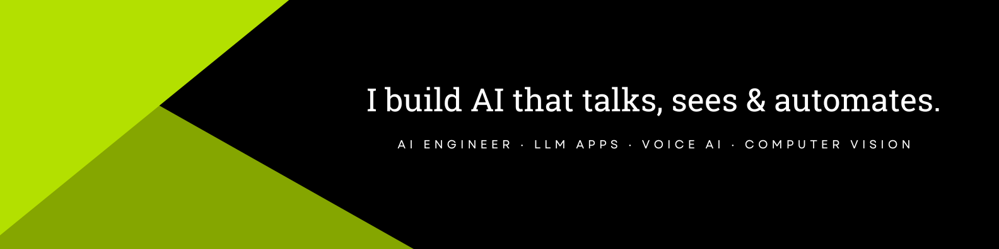

<!-- HEADER: upload your new LinkedIn banner to assets/banner.png (replace the old one) -->
<p align="center">
  
</p>

<p align="center">
  <a href="https://mominaportfolio.netlify.app/"></a>
  <a href="https://www.linkedin.com/in/momina-ather/"></a>
  <a href="https://medium.com/@mominaatherahmed"></a>
  <a href="mailto:mominaatherahmed@gmail.com"></a>
</p>

---

## 👋 About Me

I'm an **AI Engineer** with 2+ years of experience taking AI products from idea to production: **LLM apps, RAG, real-time voice AI and computer vision**.

```
🤖  AI Engineer @ Cloudtenants: LLM agents + computer vision for real businesses
🏥  Built a hospital AI assistant on web + WhatsApp: 40+ doctors, 20–30 bookings/day, 80% less manual scheduling
👁️  Built multi-camera AI surveillance: intruders, loitering & drowsy-guard detection (85% accuracy)
✍️  Writing an LLM Evaluation series on Towards AI
🛡️  Exploring AI security: where LLMs and cybersecurity meet
```

💼 **Open to remote AI Engineer roles and freelance projects** in LLM apps, voice AI and automation.

---

## 🚀 Featured Projects

| Project | What it does | Stack |
| :------ | :----------- | :---- |
| **[Agentic RAG](https://github.com/momina02/Agentic-Rag)** | RAG with no vector DB: an LLM with file tools searches notes like a developer and answers with `file:line` citations | `Python` `Pydantic AI` `Groq` |
| **[Real-Time Voice Agent](https://github.com/momina02/Voice-Agent)** | Talk to it like a phone call: live speech-to-text, LLM reasoning and natural voice replies | `FastAPI` `WebSocket` `Deepgram` `OpenAI` `Cartesia` |
| **[Bilingual Voice AI Assistant](https://github.com/momina02/Web-Based-Chatbot)** | Speak or type in Urdu, English or Roman Urdu; replies in your language from approved content only | `Flask` `GPT-4o-mini` `Whisper` `OpenAI TTS` `Docker` |
| **[QueryWise](https://github.com/momina02/QueryWise)** | Chat with your PDFs, Word, Excel and PowerPoint files | `LangChain` `Pinecone` `Hugging Face` `Groq` `Streamlit` |
| **[WhatsApp Lead Generation Bot](https://github.com/momina02/Lead-Generation-Bot)** | Auto-replies to customers, scores leads Hot / Warm / Cold, logs every chat | `Selenium` `FastAPI` `LangChain` `ChromaDB` `MySQL` |
| **[Appendicitis Detection System](https://github.com/momina02/Appendicitis-Prediction-System)** | LLaMA-3 medical chatbot + symptom test + YOLOv8 ultrasound analysis | `React` `FastAPI` `YOLOv8` `Groq` `Firebase` |

<p align="center">
  <a href="https://mominaportfolio.netlify.app/projects"></a>
</p>

---

## ✍️ Writing: LLM Evaluation Series

- 📌 [Offline vs. Online Evals: How to Keep Evaluating Your AI App After It Goes Live](https://medium.com/towards-artificial-intelligence/offline-vs-online-evals-how-to-keep-evaluating-your-ai-app-after-it-goes-live-efb7fcc3144c) · *Towards AI*
- [LLM Evaluation 105: Who Actually Grades Your LLM?](https://pub.towardsai.net/llm-evaluation-105-who-actually-grades-your-llm-programmatic-human-and-llm-as-a-judge-29adf7c1422b) · *Towards AI*
- [LLM Evaluation 104: Why Your AI Application Needs Multiple Eval Pipelines](https://pub.towardsai.net/llm-evaluation-104-why-your-ai-application-needs-multiple-eval-pipelines-b5c52e7da501) · *Towards AI*
- [Everything You Need to Know About LLM Evaluation: A Complete Recap](https://medium.com/@mominaatherahmed/everything-you-need-to-know-about-llm-evaluation-a-complete-recap-0976ee27a580)

➡️ [All articles on Medium](https://medium.com/@mominaatherahmed)

---

## 🧰 Tech Stack

**AI & LLMs**
<p>
  
  
  
  
  
  
  
  
</p>

**Voice & Computer Vision**
<p>
  
  
  
  
  
  
</p>

**Backend, Data & DevOps**
<p>
  
  
  
  
  
  
  
  
  
  
  
</p>

---

<details>
<summary><b>🏅 Kaggle badges</b></summary>
<br/>
<p align="center">
    
    
    
    
</p>
<p align="center"><a href="https://www.kaggle.com/mominaather">kaggle.com/mominaather</a></p>
</details>

---

<p align="center">
  <b>Need an AI chatbot, voice agent or automation for your business? Let's talk.</b><br/>
  📩 <a href="mailto:mominaatherahmed@gmail.com">mominaatherahmed@gmail.com</a> · 🌐 <a href="https://mominaportfolio.netlify.app/">Portfolio</a> · 💼 <a href="https://www.linkedin.com/in/momina-ather/">LinkedIn</a>
</p>
